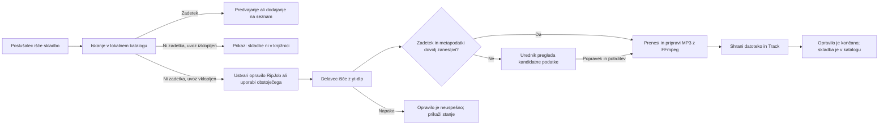

# Soundroom: funkcionalnosti in obseg

## Uporabniške vloge

Vloge preverja zaledni sistem pri vsaki zaščiteni zahtevi; skrivanje gumbov v uporabniškem vmesniku ni varnostni mehanizem.

| Vloga | Lahko počne | Omejitve / nima pravic za |
|---|---|---|
| **Poslušalec** | Prijava; iskanje in pretakanje skladb; upravljanje svojih seznamov; pridobivanje priporočil in sprožitev opravila za manjkajočo skladbo, kadar je samodejni uvoz vklopljen. | Nima pravice do nalaganja ali brisanja datotek, spreminjanja metapodatkov, upravljanja uporabnikov ali sistemskih nastavitev ter potrjevanja dvoumnih uvozov. |
| **Urednik knjižnice** | Vse, kar lahko počne poslušalec, in nalaganje skladb, urejanje njihovih metapodatkov ter pregledovanje in potrjevanje nejasnih opravil uvoza. | Ustvarjanje skrbniških računov, spreminjanje vlog, spreminjanje globalne nastavitve samodejnega uvoza ali varnostnih nastavitev aplikacije. |
| **Skrbnik sistema** | Vse pravice urednika ter ustvarjanje, deaktiviranje in dodeljevanje vlog uporabnikom; vklop ali izklop samodejnega uvoza; pregled, ponovni zagon, potrditev ali preklic opravil. | Ne more obiti prijave, preverjanja lastništva ali varnostnih omejitev; ne more predvajati datoteke, ki je v knjižnici ni ali ni več dosegljiva. |

Prvi skrbniški račun se ustvari ob lokalnem zagonu. Novi računi so v prvi različici ustvarjeni ali povabljeni s strani skrbnika; javna registracija je izklopljena.

## Predvidene funkcionalnosti

Oznaka **MVP** pomeni funkcionalnost, ki sodi v prvo delujočo različico. MVP ima sedem funkcionalnosti; šest jih je neposredno vezanih na glasbeno knjižnico, uvoz, poslušanje ali odkrivanje glasbe.

1. **Prijava, odjava in vloge uporabnikov (MVP)** – skrbnik ustvari račune; zaledni sistem preverja vlogo in dovoljenja pri vsaki zaščiteni zahtevi.
2. **Uvoz glasbe v knjižnico (MVP)** – skrbnik ali urednik naloži MP3; sistem preveri dejanski format datoteke in konfigurirano omejitev velikosti ter prebere metapodatke. Če datoteka nima naslova ali izvajalca, ju uporabnik vnese v obrazec pred uvozom.
3. **Iskanje po lokalni knjižnici (MVP)** – poslušalec išče po naslovu skladbe ali izvajalcu in vidi rezultate, ki jih je mogoče predvajati.
4. **Samodejni uvoz ob manjkajočem zadetku (MVP)** – kadar je nastavitev vklopljena (privzeto je izklopljena), iskanje brez rezultata sproži ali ponovno uporabi opravilo za iskanje in prenos prek YouTuba. `yt-dlp` najprej poišče največ pet kandidatov; sistem preveri naslov, izvajalca ter omejitev dolžine, preden začne prenos. Zanesljiv zadetek se obdela z orodjem FFmpeg, dvoumen pa počaka na potrditev urednika. Urednik lahko pred potrditvijo popravi naslov ali izvajalca kandidata. Skrbnik določi največjo dolžino skladbe; aktivna opravila z enako normalizirano poizvedbo se združijo.
5. **Predvajalnik in čakalna vrsta (MVP)** – predvajanje, pavza, premik po skladbi, naslednja/prejšnja skladba in dodajanje skladb v trenutno čakalno vrsto; predvajalnik je uporaben tudi na ozkem zaslonu telefona.
6. **Osebni seznami predvajanja (MVP)** – poslušalec ustvari zaseben seznam ter mu doda, odstrani in prerazporedi skladbe iz knjižnice.
7. **Seznam »Odkrij podobno« (MVP)** – uporabnik izbere od ene do treh skladb iz knjižnice; strežnik za vsako izhodiščno skladbo prek Last.fm pridobi največ 20 podobnih skladb. Kandidatom normalizira naslov in izvajalca, podvojene zadetke združi ter izloči izbrane izhodiščne skladbe. Uvrstitev je vsota podobnostnih vrednosti Last.fm čez vsa izhodišča; ob izenačenju ima prednost kandidat, ki se pojavi pri več izhodiščih. Uporabniku ponudi največ 20 najvišje uvrščenih skladb, ki so že v lokalni knjižnici, in jih lahko shrani kot nov seznam. Če ujemanj ni, prikaže prazno stanje in uporabnika usmeri na običajno iskanje; priporočilo samo ne sproži dodatnih prenosov.
8. **Priljubljene skladbe in zgodovina poslušanja** – uporabnik označi priljubljene skladbe in pregleduje svojo zgodovino.
9. **Strani izvajalcev in albumov ter napredni filtri** – filtriranje kataloga po izvajalcu, albumu, letu ali oznakah.
10. **Deljeni in sodelovalni seznami** – uporabnik povabi druge račune k urejanju določenega seznama.
11. **Scrobbling v ListenBrainz** – aplikacija pošilja predvajanja v uporabnikov račun ListenBrainz, če ga ta poveže.
12. **Boljša administracija knjižnice** – prikaz porabe prostora, kvote po uporabniku, čiščenje začasnih datotek ter orodja za varnostno kopiranje in obnovitev.
13. **Razširjene možnosti predvajanja** – podpora za dodatne zvočne formate poleg MP3, pretvorba formatov ob uvozu ter prenos izbranih skladb za poslušanje brez povezave v PWA.

Funkcionalnosti 8–13 niso del MVP-ja, so pa del načrta tega projekta in bodo implementirane po prvi delujoči različici.

### Jedrni potek: iskanje in uvoz manjkajoče skladbe

Opravilo se izvaja asinhrono, zato se iskalna zahteva hitro zaključi. Uporabniški vmesnik preverja stanje opravila in po uspehu osveži katalog. Stanja so `queued`, `searching`, `downloading`, `processing`, `needs_review`, `completed`, `failed` in `cancelled`. Za nedvoumno poizvedbo se lahko uporabijo rezultati samodejno; pri nejasnem izvajalcu ali naslovu se prenos ne objavi brez pregleda.

### Priporočeno zaporedje implementacije MVP-ja

1. Najprej postaviti PostgreSQL, migracije, skrbniški račun, prijavo in preverjanje vlog.
2. Izdelati skladbe/izvajalce, nalaganje datotek MP3 ter iskanje po lokalni knjižnici; to zagotovi zanesljiv vir glasbe tudi, ko zunanje storitve niso na voljo.
3. Dodati avtorizirano pretakanje z HTTP Range, predvajalnik in osebne sezname. Po tem koraku je mogoče aplikacijo že uporabljati z naloženo knjižnico.
4. Dodati trajno tabelo `rip_jobs` in delavca; najprej preizkusiti vsa stanja ter obravnavo napak z izklopljenim samodejnim uvozom, nato omogočiti nastavitev.
5. Dodati Last.fm predloge in povezovanje z lokalnim katalogom. Priporočila ne smejo blokirati predvajanja ali samodejno sprožiti več uvozov.
6. Preveriti odzivni PWA v telefonu z Androidom in dostop do strežnika prek HTTPS.

## Kasnejše nadgradnje

Možne razširitve po zaključku projekta. Niso del 13 predvidenih funkcionalnosti in niso načrtovane za implementacijo v tem projektu.

- **Izvorna Android aplikacija z Android Auto** – ločen Android odjemalec na istem zaledju, ki predvajanje upravlja tudi prek avtomobilskega zaslona.
- **Izvoz in uvoz seznamov v formatu M3U** – seznami predvajanja se lahko prenesejo v zunanje predvajalnike in uvozijo nazaj v aplikacijo.
- **Samodejno dopolnjevanje metapodatkov in naslovnic** – manjkajoči podatki o albumu, letu in naslovnici se poiščejo v odprtih bazah, na primer MusicBrainz in Cover Art Archive.
- **Zaznavanje podvojenih skladb po vsebini** – poleg zgoščene vrednosti datoteke se primerja akustični prstni odtis (npr. Chromaprint), da se najdejo enake skladbe v različnih formatih ali kakovosti.
- **Obveščanje skrbnika o neuspelih uvozih** – e-poštno obvestilo ali obvestilo v aplikaciji, ko opravilo `rip_jobs` neuspe ali čaka na pregled dlje od določenega časa.
- **Slovenski prevod uporabniškega vmesnika** – privzeti jezik vmesnika je angleški; slovenščina je dodatni jezik.
- **Shramba v objektnem pomnilniku in več instanc API-ja** – datoteke MP3 v združljivem objektnem pomnilniku (npr. S3) in zagon več instanc API-ja za večjo obremenitev.

## Out of scope (zunaj obsega projekta)

Naslednje funkcionalnosti v tem projektu ne bodo implementirane in niso uvrščene med kasnejše nadgradnje.

- Predvajanje in uvoz glasbe iz zunanjih komercialnih katalogov ter povezovanje z njihovimi uporabniškimi računi ali priporočili.
- Javna večnajemniška uporaba, pri kateri bi aplikacija služila nepovezanim uporabnikom, vključno z javno registracijo.
- Prijava z računi zunanjih ponudnikov (npr. Google ali Apple); prijava poteka samo z lokalnimi računi.
- Videoposnetki, podkasti, besedila skladb, družabni komentarji in javno objavljanje seznamov.
- Lasten model umetne inteligence ali strojnega učenja za priporočila; priporočila temeljijo samo na podatkih Last.fm.
- Podpora za zaščitene (DRM) datoteke in odstranjevanje takšne zaščite.
- Plačljive naročnine in obračunavanje uporabe.
