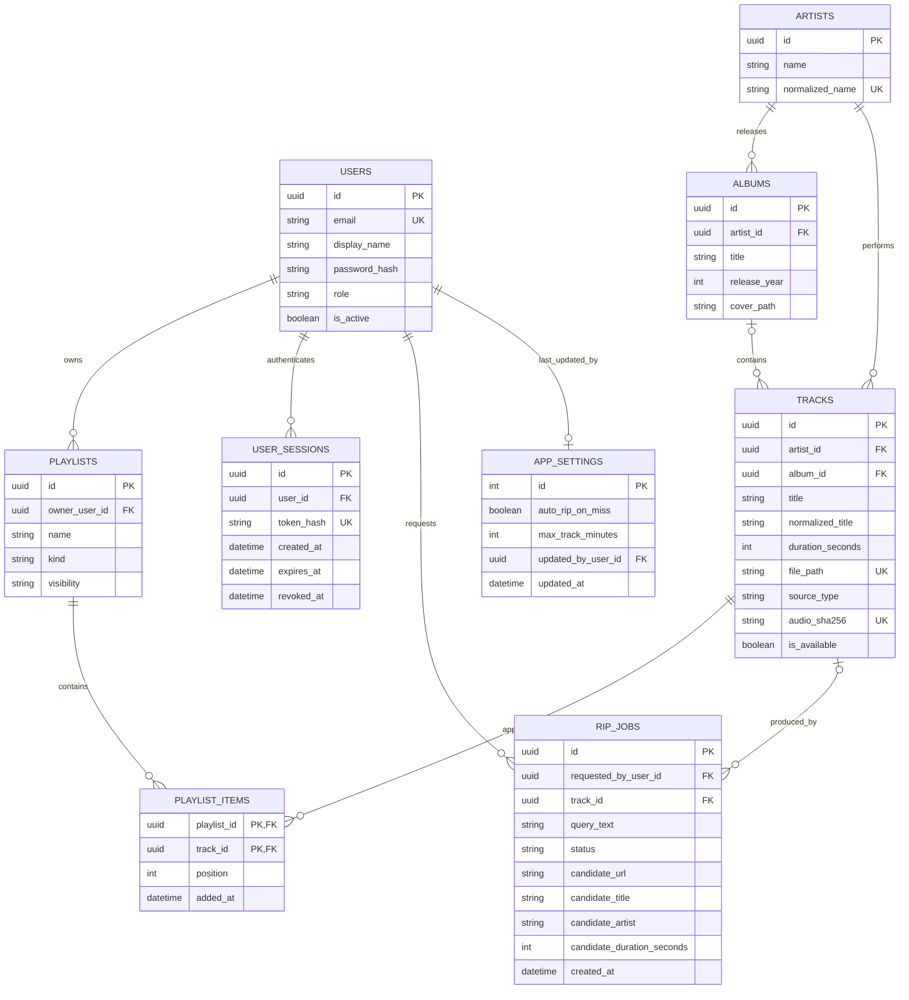

# Soundroom: podatkovni model

## Izhodišča

Relacijska baza PostgreSQL hrani uporabnike, metapodatke, sezname predvajanja in stanje opravil. Velike zvočne datoteke niso shranjene kot binarni podatki v bazi: hranijo se v konfigurirani trajni shrambi, v tabeli `tracks` pa je shranjena njihova relativna pot. V prvi različici ima skladba enega glavnega izvajalca in največ en album; podpora za več izvajalcev na skladbo je mogoča kot poznejša nadgradnja.

## Entitete in glavna polja

| Entiteta | Glavna polja | Namen |
|---|---|---|
| `users` | `id` (PK), `email` (UNIQUE), `display_name`, `password_hash`, `role` (`listener`, `editor`, `admin`), `is_active`, `created_at` | Računi in avtorizacija. Geslo se shrani samo kot zgoščena vrednost, nikoli kot navadno besedilo. |
| `user_sessions` | `id` (PK), `user_id` (FK), `token_hash` (UNIQUE, SHA-256), `created_at`, `expires_at`, `revoked_at` (NULL) | Strežniške prijavne seje; v bazi je SHA-256 zgoščena vrednost naključnega žetona, ne vrednost sejnega piškotka. |
| `artists` | `id` (PK), `name`, `normalized_name` (UNIQUE) | Kanonični zapis izvajalca za prikaz in iskanje. |
| `albums` | `id` (PK), `artist_id` (FK), `title`, `release_year` (NULL), `cover_path` (NULL) | Metapodatki albuma; skladba je lahko brez znanega albuma. |
| `tracks` | `id` (PK), `artist_id` (FK), `album_id` (FK, NULL), `title`, `normalized_title` (indeks), `duration_seconds`, `file_path` (UNIQUE), `mime_type`, `source_type` (`upload` ali `youtube`), `source_url` (NULL), `audio_sha256` (UNIQUE), `is_available`, `created_at` | Metapodatki skladbe in sklic na datoteko v shrambi. Normaliziran naslov podpira iskanje in ujemanje z Last.fm; `audio_sha256` pomaga zaznati podvojene datoteke. |
| `playlists` | `id` (PK), `owner_user_id` (FK), `name`, `description` (NULL), `kind` (`manual` ali `recommendation`), `visibility` (v različici MVP samo `private`), `created_at`, `updated_at` | Uporabniku pripadajoči seznami predvajanja. |
| `playlist_items` | `playlist_id` (PK, FK), `track_id` (PK, FK), `position`, `added_at` | Povezovalna entiteta med seznamom in skladbo; sestavljeni primarni ključ je (`playlist_id`, `track_id`), `position` določa vrstni red. Ista skladba se v različici MVP na istem seznamu pojavi največ enkrat. |
| `rip_jobs` | `id` (PK), `requested_by_user_id` (FK), `query_text`, `normalized_query`, `stanje`, `candidate_url` (NULL), `candidate_title` (NULL), `candidate_artist` (NULL), `candidate_duration_seconds` (NULL), `track_id` (FK, NULL do uspešnega uvoza), `error_message` (NULL), `created_at`, `started_at` (NULL), `finished_at` (NULL) | Trajna vrsta opravil za samodejni uvoz. Kandidatna polja uredniku prikažejo zadetek in mu omogočijo popravek metapodatkov pred potrditvijo. `stanje` je eden od stanj, opisanih v dokumentu [funkcionalnosti](02-funkcionalnosti-in-obseg.md). |
| `app_settings` | `id` (PK, v različici MVP ena vrstica), `auto_rip_on_miss`, `max_track_minutes`, `updated_by_user_id` (FK), `updated_at` | Globalne nastavitve, ki jih upravlja skrbnik; zlasti stikalo za samodejni uvoz ob neuspešnem iskanju. Začetni vrednosti sta `auto_rip_on_miss = false` in `max_track_minutes = 15`. |

## Povezave med entitetami

- En `artist` ima lahko več `tracks`; vsaka skladba ima enega glavnega izvajalca.
- En `artist` ima lahko več `albums`; album ima enega glavnega izvajalca.
- En `album` lahko vsebuje več skladb; `tracks.album_id` je lahko prazen, če podatek ni znan.
- En `user` ima lahko več `playlists`; vsak seznam ima natanko enega lastnika.
- En `user` ima lahko več `user_sessions`; vsaka seja pripada enemu uporabniku in jo je mogoče preklicati ob odjavi ali deaktivaciji računa.
- `playlists` in `tracks` so povezani mnogo-proti-mnogo prek `playlist_items`.
- En `user` lahko sproži več `rip_jobs`; po uspešnem opravilu se `rip_jobs.track_id` poveže z uvoženo skladbo.
- En `user` lahko spremeni sistemsko nastavitev; `app_settings.updated_by_user_id` beleži zadnjega skrbnika, ki jo je spremenil.

## Osnutek modela

## Celovitost podatkov in datotek

- Zunanji ključi preprečujejo sezname brez lastnika ali elemente seznama brez obstoječe skladbe.
- Za `playlist_items` veljata enoličnost (`playlist_id`, `track_id`) in enoličen položaj (`playlist_id`, `position`), da seznam nima podvojenih skladb ali dveh skladb na istem mestu.
- Za `rip_jobs` je indeks na `normalized_query` in `stanje`; pri ustvarjanju novega opravila API transakcijsko preveri, ali za isto normalizirano poizvedbo že obstaja aktivno opravilo.
- Pred ustvarjanjem `tracks` delavec preveri, da so naslov, izvajalec in datoteka veljavni; potrjeni izvajalec se poveže z obstoječim zapisom `artists` ali se ustvari nov.
- Brisanje skladbe naj jo najprej označi kot nedosegljivo (`is_available = false`), da obstoječi seznami ne izgubijo povezav. Datoteka se fizično odstrani šele po preverjanju, da je odstranitev dovoljena.
- Delavec naj datoteko najprej pripravi v začasnem imeniku in jo šele po uspešnem preverjanju premakne na končno pot. V bazi se skladba označi kot razpoložljiva šele po uspešnem zapisu datoteke.
- Poizvedbe za sezname predvajanja vedno preverijo lastništvo. Uporabnik ne more z ugibanjem ID-ja spreminjati seznama drugega uporabnika.
- V prvi različici zgodovina poslušanja, všečki in povezani računi Last.fm niso obvezni za priporočila; priporočilni seznam nastane iz skladb, ki jih uporabnik izbere kot izhodišče.
