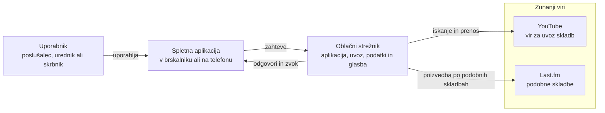

# Soundroom: arhitektura in tehnološki sklad

## Arhitektura

Soundroom je spletna aplikacija z ločenim uporabniškim vmesnikom in zalednim sistemom. Zaledni sistem sestavljajo REST API, delovni proces za opravila, relacijska baza in konfigurirana trajna shramba glasbenih datotek. Lokacija gostovanja ni del zasnove; komponente se lahko zaženejo skupaj ali na ločenih storitvah, če si zagotovijo dostop do baze in trajne shrambe.

### Glavni deli sistema

1. **Spletni odjemalec / PWA** – odziven uporabniški vmesnik za prijavo, iskanje, predvajanje, sezname predvajanja in stanje uvoza. PWA se lahko namesti na Androidov začetni zaslon. Media Session API v brskalniku lahko poveže predvajanje z običajnimi sistemskimi upravljalnimi elementi telefona.
2. **Python REST API** – FastAPI preverja prijavo in vloge, preverja veljavnost podatkov, išče po katalogu, upravlja sezname, pretaka zvočne datoteke ter sprejema zahteve za priporočila in uvoz.
3. **PostgreSQL** – hrani uporabnike, metapodatke, sezname, sistemsko nastavitev in trajna opravila uvoza. API in delavec se povežeta z isto bazo.
4. **Trajna shramba zvoka** – datoteke MP3 se hranijo zunaj PostgreSQL v shrambi, ki je konfigurirana za API in delavca. V lokalnem Docker Compose okolju je to trajni volumen; druga okolja lahko uporabijo trajni datotečni volumen ali ustrezno prilagojen objektni pomnilnik. API jih po preverjanju uporabniških pravic pretaka z zahtevki HTTP Range, da lahko predvajalnik preskakuje po skladbi.
5. **Delavec za uvoz** – iz `rip_jobs` prevzame opravilo, izvede omejeno iskanje z `yt-dlp`, pripravi MP3 z FFmpeg/ffprobe, shrani datoteko in posodobi stanje v bazi. Opravila preživijo ponovni zagon aplikacije.
6. **Last.fm API** – zaledni sistem ga uporablja samo za podatke o podobnih skladbah. Ključ API je v okolju zalednega sistema; nikoli se ne pošlje brskalniku. Rezultati se povežejo z lokalnimi skladbami, zato Last.fm ne posreduje ali predvaja zvoka.

### Komunikacija med deli

- PWA se z API-jem pogovarja prek HTTPS in JSON REST zahtevkov.
- Prijavni podatki se pošiljajo prek zaščitenega strežniškega sejnega piškotka; vsaka pot, ki spreminja zasebne podatke ali vrača zvok, preveri sejo in dovoljenja. Spreminjajoče se zahteve ne uporabljajo `GET`; API preveri izvor zahtevkov oziroma CSRF žeton.
- Iskanje najprej išče po lokalnem katalogu. Če ni zadetka in je globalna nastavitev omogočena, odjemalec pošlje ločen `POST` za ustvarjanje opravila uvoza. API združi podvojena aktivna opravila in takoj vrne njihov ID. Odjemalec redno preverja stanje opravila; uspeh prikaže skladbo in omogoči predvajanje.
- Delavec bere opravila iz PostgreSQL, poizvedbo preveri in `yt-dlp` zažene z ločenimi argumenti, ne kot sestavljen ukaz lupine. Poišče največ pet kandidatov; če je kandidat zanesljiv, preveri dolžino, ga obdela z FFmpeg/ffprobe, zvočno datoteko zapiše v trajno shrambo ter nato posodobi vrstico `rip_jobs` in katalog `tracks`. Če je kandidat nejasen, shrani podatke za prikaz v opravilo in počaka na urednikov popravek ali potrditev.
- API pokliče Last.fm ob zahtevi za predloge, primerja predloge z lokalnimi izvajalci in naslovi skladb ter vrne najdene rezultate. Če je zunanji API ni dosegljiv, lokalno iskanje, predvajanje in seznami še vedno delujejo.

### Diagram arhitekture

Diagram prikazuje glavne dele na visoki ravni brez imen tehnologij in protokolov; tehnologije so navedene v razdelku »Tehnološki sklad«. »Oblačni strežnik« je splošna oznaka za strežniški del, lokacija gostovanja pa ni predpisana.

## Avtentikacija in upravljanje uporabnikov

- Ob namestitvi se ustvari začetni skrbnik; ta nato ustvari ali povabi poslušalce in urednike.
- Gesla se zgoščujejo z Argon2id. Po uspešni prijavi FastAPI z modulom `secrets` ustvari naključni sejni žeton; brskalnik ga prejme samo v piškotku `HttpOnly`, `SameSite=Lax` in `Secure` pri HTTPS.
- V tabeli `user_sessions` se shrani SHA-256 zgoščena vrednost žetona, ne sam žeton. Odjava prekliče sejo, deaktivacija uporabnika pa prepreči uporabo vseh njegovih sej.
- Vloge `listener`, `editor` in `admin` se preverjajo v API-ju. Poslušalec upravlja samo svoje sezname; urednik lahko upravlja glasbeno vsebino; skrbnik lahko upravlja uporabnike in sistemske nastavitve.
- Končna dostopna točka za predvajanje zvoka prav tako preverja uporabnika in pravico do skladbe. Spreminjajoče se zahteve preverjajo izvor oziroma CSRF žeton. Zvočne datoteke niso javno dostopne neposredno prek imenika ali URL-ja YouTuba.
- Uporabniški vmesnik ob zagonu pokliče `GET /api/auth/me`. Odgovor 401 pomeni, da seja ni veljavna, in uporabnika preusmeri na prijavo. CSRF žeton, ki ga uporabniški vmesnik pošilja pri spreminjajočih zahtevkih, dobi iz istega odgovora.

## Lokalni zagon

Za lokalni razvoj se uporabijo Docker Compose, Python 3.12+ za zaledni sistem in Node.js LTS za razvojni strežnik ter gradnjo uporabniškega vmesnika. Compose zažene spletni odjemalec, FastAPI, Python delavca in PostgreSQL; zvočne datoteke se hranijo v trajnem nosilcu, npr. `./data/audio`.

Način produkcijskega gostovanja ni predpisan. Docker Compose je izbran za ponovljiv lokalni zagon; produkcijska postavitev lahko uporablja vsebnike ali storitve, zagnane ločeno. V obeh primerih morajo biti konfigurirani povezava do PostgreSQL, okoljske skrivnosti, HTTPS ter trajna shramba, dosegljiva API-ju in delavcu.

1. Ustvari lokalni `.env` iz vzorčne konfiguracije; nastavi `DATABASE_URL`, `MEDIA_STORAGE_PATH`, `LASTFM_API_KEY`, `INITIAL_ADMIN_EMAIL` in `INITIAL_ADMIN_PASSWORD`. `.env` se ne doda v Git.
2. Zaženi `docker compose up --build`.
3. Ob prvem zagonu se izvedejo migracije Alembic in ustvari začetni skrbniški račun iz konfiguriranih poverilnic; skrbnik mora začetno geslo zamenjati.
4. V razvojnem okolju je spletni vmesnik dostopen na `http://localhost:5173`, FastAPI pa na `http://localhost:8000`; Vite razvojni proxy posreduje API zahtevke. Za uporabo z druge naprave, nameščanje PWA prek omrežja ali dostop od zunaj se aplikacija postavi za HTTPS povratni proxy, npr. Caddy. PostgreSQL in imenik z datotekami se ne izpostavljata neposredno internetu.

## Tehnološki sklad

| Področje | Izbor za prvo različico |
|---|---|
| Frontend | React, TypeScript, Vite in `vite-plugin-pwa`; odziven vmesnik, PWA manifest in servisni delavec; `HTMLAudioElement` in Media Session API za predvajalnik. |
| Backend | Python 3.12+, FastAPI, Pydantic 2, Uvicorn in REST/JSON API. |
| Podatkovna baza | PostgreSQL; SQLAlchemy 2 za ORM in Alembic za migracije. |
| Avtentikacija (zaledni sistem) | Argon2id (`argon2-cffi`) za gesla; naključni sejni žeton v piškotku `HttpOnly`, njegova zgoščena vrednost v tabeli `user_sessions`; vloge se preverjajo v poteh API-ja. |
| Avtentikacija (uporabniški vmesnik) | `@tanstack/react-query` za stanje prijave prek `GET /api/auth/me`, `react-router` za zaščitene poti in preusmeritve na prijavo ter `react-hook-form` z `zod` za prijavni obrazec. Piškotka uporabniški vmesnik ne bere, ker je `HttpOnly`. |
| Glasbene datoteke | Konfigurirana trajna shramba; lokalno Docker volumen `./data/audio`; pretakanje HTTP Range; MP3 kot edini zahtevani format MVP-ja. |
| Uvoz | Ločen Python delavec; `yt-dlp` za omejeno iskanje/pridobitev in FFmpeg/ffprobe za pripravo MP3 ter branje trajanja/metapodatkov. Zunanji procesi se zaženejo brez lupinskega ukaza. |
| Priporočila | Last.fm REST API, metoda `track.getSimilar`, klicana z `httpx`; okoljska spremenljivka zalednega sistema `LASTFM_API_KEY`. |
| Lokalni razvoj | Docker Compose, `.env`, Python 3.12+, Node.js LTS za Vite, Git in `pytest`; PostgreSQL ter glasbene datoteke z ločenimi trajnimi nosilci. |

## Arhitekturne odločitve

1. **Python/FastAPI za API in delavca; en API namesto mikroservisov.** Isti jezik omogoča skupno uporabo podatkovnega modela in validacij. En API ter ločen delavec sta za študijski projekt dovolj preprosta za razumevanje in zagon z enim ukazom Compose; delavec je ločen zato, ker lahko iskanje in priprava zvoka trajata dlje od spletne zahteve.
2. **PostgreSQL za metapodatke, ločena trajna shramba za zvok.** Relacijske povezave so primerne za uporabnike, sezname in opravila; velike datoteke ostanejo v shrambi, ki jo je mogoče prilagoditi okolju gostovanja. Ločitev omogoča ločeno varnostno kopiranje baze in medijev.
3. **Trajna tabela opravil namesto prenosa znotraj iskalnega zahtevka.** Uporabnik takoj dobi odgovor in stanje opravila; ponovni zagon strežnika ne izgubi čakalne vrste. Združevanje enakih poizvedb zmanjša podvojene prenose.
4. **Last.fm samo za metapodatke priporočil.** `track.getSimilar` omogoča konkretno povezavo med izbranimi semenskimi skladbami in podobnimi predlogi. Predloge se ujemajo z lokalnim katalogom; izpad Last.fm zato ne ustavi predvajanja. Ključ ostane v okolju zalednega sistema.
5. **Odziven PWA za MVP.** En spletni uporabniški vmesnik podpira namizni brskalnik in namestitev v telefon z Androidom, zato prva različica ne potrebuje ločene mobilne aplikacije.
6. **MP3 kot edini obvezni format MVP-ja.** Uvoz in predvajanje tako delujeta na brskalnikih in Androidu z manj razlikami med kodeki. FLAC, AAC in pretvorba formatov so razširitve, ne predpogoj za prvo delujočo različico.
7. **Avtorizacija na strežniku.** Uporabniški vmesnik, prilagojen vlogam, je uporaben, vendar ni meja varnosti; API preverja lastništvo seznamov, vlogo urednika/skrbnika in pravico do pretakanja.
8. **Lastni vir zvoka.** Soundroom pretaka datoteke iz svoje knjižnice; Last.fm se uporablja samo za metapodatke o podobnih skladbah, ne za predvajanje ali prenos zvoka.
9. **Uporabniški vmesnik brez posebne avtentikacijske knjižnice.** Sejo ureja zaledni sistem; brskalnik hrani samo žeton v piškotku `HttpOnly`, zato uporabniški vmesnik nima žetona, ki bi ga moral hraniti ali osveževati. Za stanje prijave in zaščito poti zadostujeta `@tanstack/react-query` in `react-router`. Knjižnice, ki same hranijo žeton v brskalniku, ne ustrezajo piškotku `HttpOnly`, zato jih ne uporabljamo.

## Dokumentacija zunanjega API-ja

- [Last.fm API: `track.getSimilar`](https://www.last.fm/api/show/track.getSimilar)
