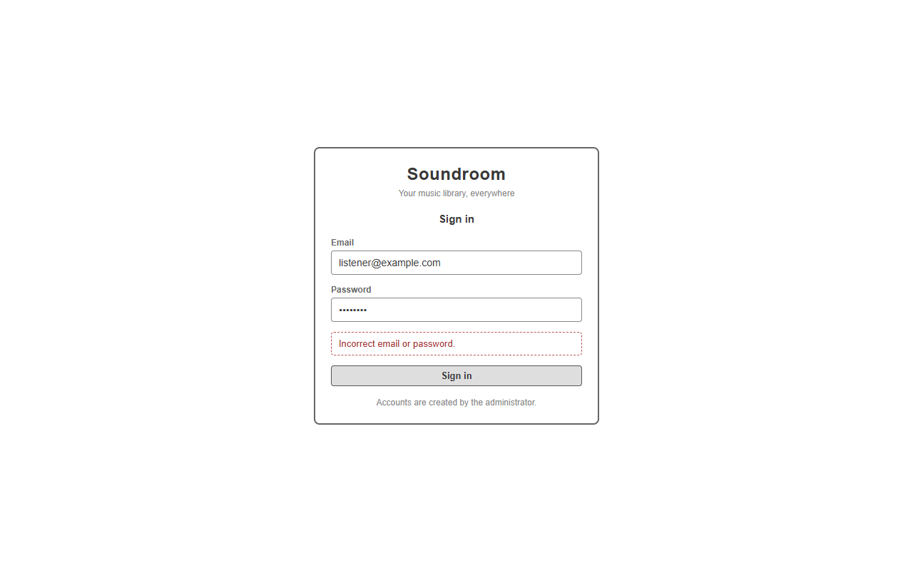
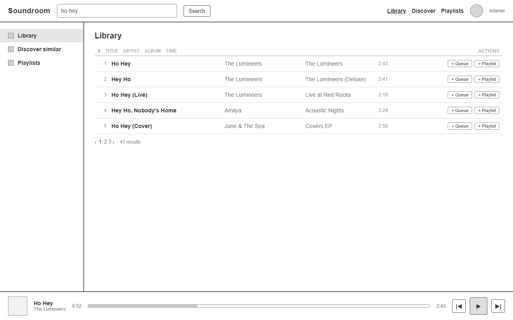
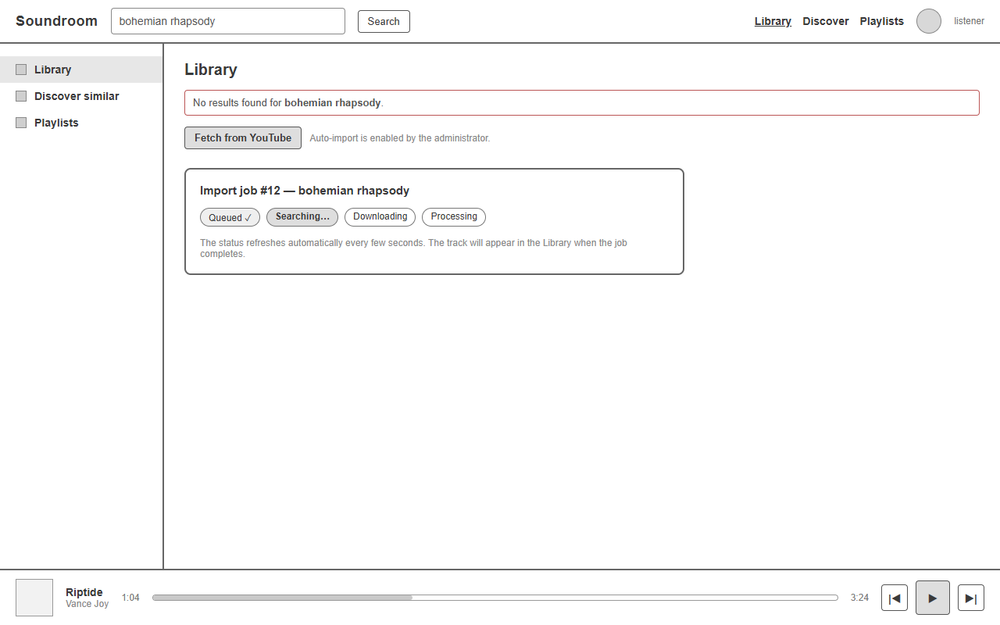
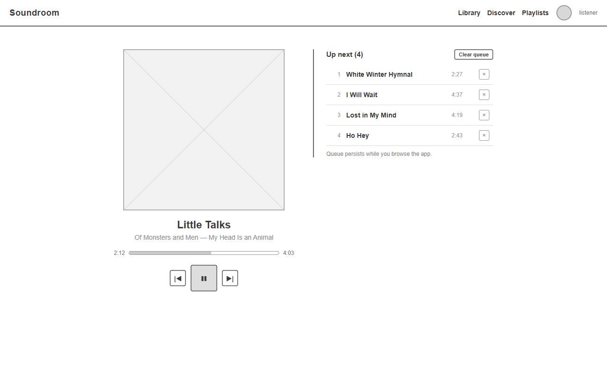
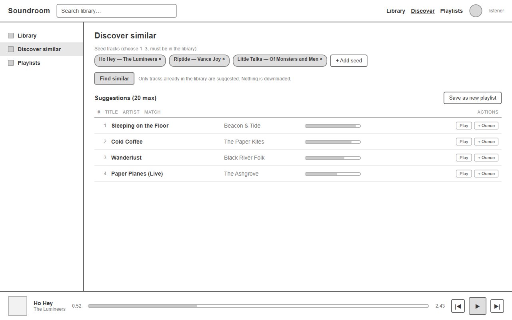
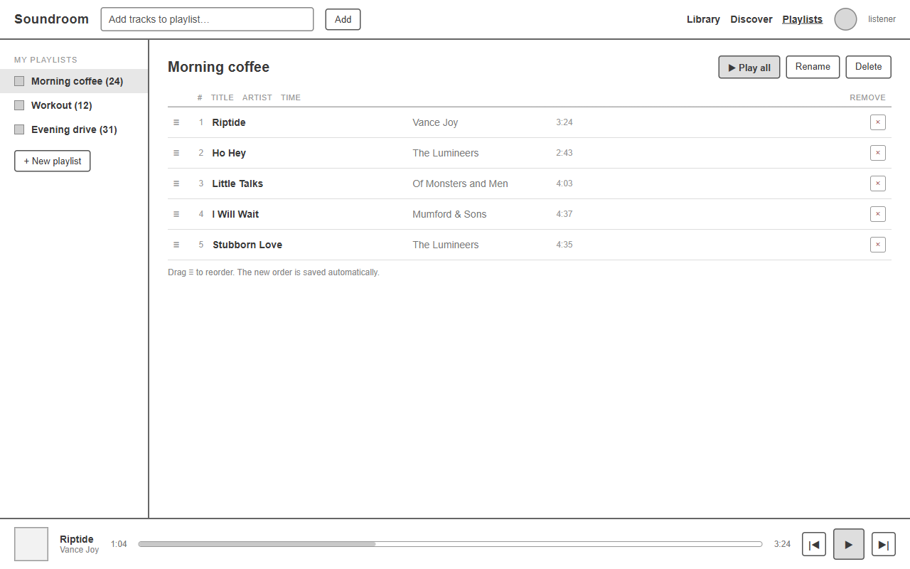
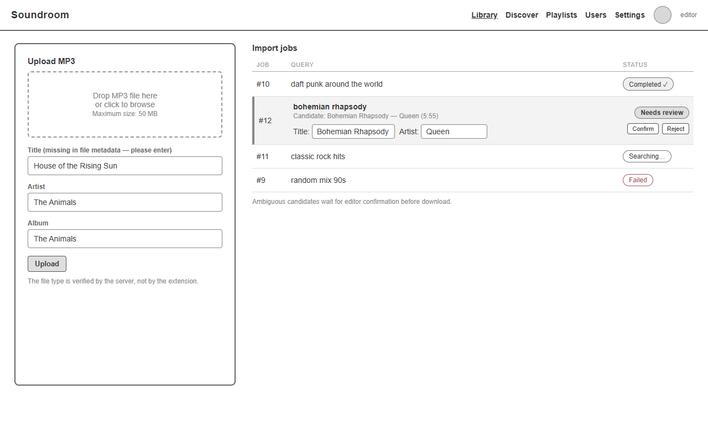
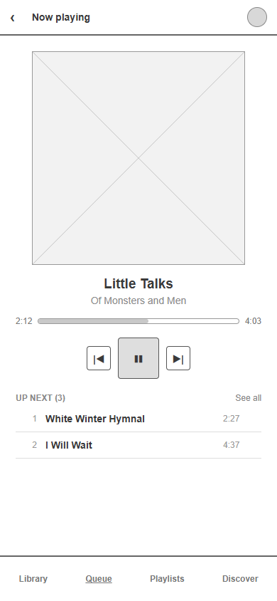

# Soundroom: wireframes

Spodnji wireframes so osnutki osnovnega izgleda aplikacije (low-fidelity): sivi okvirji, oznake delov vmesnika in vzorčni podatki. Končna barvna podoba, slike naslovnic in tipografija niso predmet tega dokumenta. Besedila v vmesniku so v angleščini, ker je to privzeti jezik uporabniškega vmesnika Soundroom (glej dokument [funkcionalnosti in obseg](02-funkcionalnosti-in-obseg.md)).

Vsak wireframe je povezan z uporabniškimi zgodbami iz dokumenta [uporabniške zgodbe](05-uporabniske-zgodbe.md); pripadajoča zgodba je navedena v opisu. Slike so v mapi `wireframes/`.

## WF-01: Prijavna stran

Prikazuje prijavni obrazec: polji za e-poštni naslov in geslo, enotno sporočilo o napaki ter opombo, da račune ustvarja skrbnik; javna registracija ni na voljo. Povezuje zgodbi **US-01** in **US-02**.

## WF-02: Iskanje z rezultati

Prikazuje pogled knjižnice z iskalnim poljem in seznamom rezultatov: naslov, izvajalec, album, trajanje, gumbi za dodajanje v čakalno vrsto in na seznam, paginacija po 20 zadetkov. Spodnja vrstica je predvajalnik, ki ostane med brskanjem po straneh; stranska navigacija povezuje knjižnico, odkrivanje podobnih skladb in sezname. Povezuje zgodbi **US-05** in **US-09**.

## WF-03: Iskanje brez zadetkov s stanjem uvoza

Prikazuje stanje, ko iskanje ni vrnilo zadetkov: sporočilo o brez zadetkov, gumb za pridobitev skladbe z YouTuba (viden samo, kadar je skrbnik vklopil samodejni uvoz) ter kartica uvoznega opravila s stanji (Queued, Searching, Downloading, Processing), ki se samodejno osvežuje. Predvajanje prej izbrane skladbe se med tem nadaljuje. Povezuje zgodbo **US-06**.

## WF-04: Skladba v predvajanju s čakalno vrsto

Prikazuje celozaslonski predvajalnik: prostor za naslovnico (označen z diagonalama), naslov, izvajalca in album, drsnik z trenutnim in skupnim časom, gumbi predvajanja ter čakalna vrsta z možnostjo odstranitve posamezne skladbe in izpraznitve vrste. Povezuje zgodbo **US-09**.

## WF-05: Odkrij podobno

Prikazuje priporočilni pogled: izbira izhodiščnih skladb (do treh), iskanje podobnih skladb, seznam predlogov s stopnjo ujemanja ter možnost shranjevanja predloga kot nov osebni seznam. Opomba pojasnjuje, da so predlagane samo skladbe, ki so že v lokalni knjižnici, in da priporočilo ne sproži prenosa. Povezuje zgodbo **US-12**.

## WF-06: Osebni seznam predvajanja

Prikazuje uporabnikove sezname v stranski vrstici in podrobnosti izbranega seznama: dodajanje skladb prek iskanja, prerazporejanje z vlečenjem (označevalnik ≡) in odstranjevanje skladb; nov vrstni red se shrani samodejno. Povezuje zgodbo **US-11**.

## WF-07: Urejanje knjižnice in pregled uvozov

Prikazuje urednikov del: nalaganje datoteke MP3 z ročno dopolnitvijo manjkajočih metapodatkov, največjo velikostjo in potrditvijo tipa datoteke na strežniku ter pregled uvoznih opravil po stanjih. Dvoumni kandidat v stanju Needs review ima urejanje naslova in izvajalca ter možnost potrditve ali zavrnitve. Povezuje zgodbama **US-04** in **US-07**; nastavitve samodejnega uvoza skrbnika (US-08) v wireframe-ih niso prikazane.

## WF-08: Predvajalnik na telefonu

Prikazuje PWA pogled na ozkem zaslonu telefona: celozaslonski predvajalnik, veliki gumbi, okrajšana čakalna vrsta in spodnja navigacija. Postavitev ne zahteva vodoravnega pomikanja in je uporabna z enim prstom. Povezuje zgodbo **US-10**.
